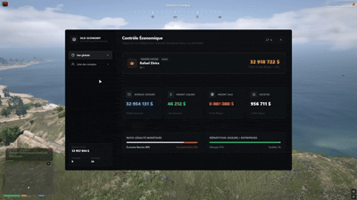

# 📊 OLD_ECONOMY | Advanced ESX Treasury & Economy Dashboard

**old_economy** is a modern, high-performance administration dashboard for FiveM servers running **ESX Legacy**. Built with **React** it provides server administrators with complete real-time visibility and control over player assets, society accounts, and macro-economic balances.



---

## ✨ Features

- **Macro Economy Overview**:
  - Live aggregated totals: Player Banks, Cash, Dirty Cash (`dirtycash`), and Society Vaults.
  - Interactive macroeconomic charts: Legal vs. Illegal currency ratio and Household vs. Enterprise distribution.
  - Real-time Top 1 wealthiest entity detection with dedicated showcase banner.

- **Unified Account Ledger**:
  - Filter by All, Players, or Societies.
  - Dynamic wealth ceiling slider (`min`/`max` auto-synced with server data).
  - Search engine supporting names, identifiers, and formatted server IDs (`ID: X` for online players, `...XXXX` for offline licenses).
  - Multi-column sort: ID, Name, Online Status, Bank, Cash, Dirty Cash, and Net Wealth.
  - Custom highlight for the server's #1 richest player.

- **Administrative Regulations & Interventions**:
  - **Individual Management**: Click any row in the ledger to credit or debit bank, cash, or dirty money with a mandatory reason logging system.
  - **Sector-wide Intervention**: Click any category card to execute mass taxes or economic injections (fixed amount or percentage) across all players or societies.

- **Optimized & Secure**:
  - Server-side rate limiter / cooldown on the manual refresh trigger.
  - Clean SQL operations powered by `oxmysql` with zero blocking overhead.
  - Transparent in-game NUI viewport with zero web artifacts.

---

## 🛠️ Requirements & Dependencies

- **Framework**: `es_extended` (ESX Legacy)
- **Database Wrapper**: `oxmysql`
- **Society Accounts**: `esx_addonaccount`

---

## 📦 Installation

1. Download or clone this repository into your server's `resources` directory:
   ```bash
   resources/[standalone]/old_economy